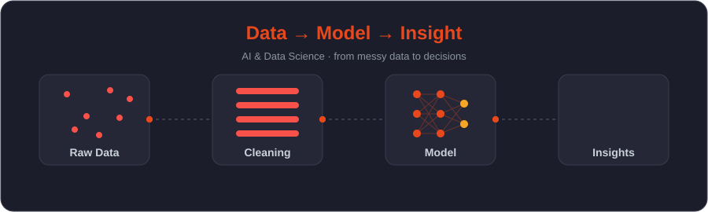

  

  

  <a href="https://my-port-folio-dusky-chi.vercel.app/"><b>🌐 View My Portfolio</b></a>

---

## 🔍 About Me

- 🎓 BS Artificial Intelligence student at **Dawood University of Engineering & Technology (DUET)**
- 📜 Data Science certified, **NED University**
- 💼 Internships in **Data Analytics** and **Data & AI Automation**
- 📊 Freelancer on **Fiverr** and **Upwork**, specializing in **data cleaning** and **Power BI dashboards**
- 🎥 Founder of **[Programify](https://programify.online)**, teaching AI, Python, SQL and automation in Urdu/Hindi
- 🛠️ I regularly build and share AI and automation projects publicly
- 🌐 Portfolio: **[my-port-folio-dusky-chi.vercel.app](https://my-port-folio-dusky-chi.vercel.app/)**
- 📍 Based in Pakistan 🇵🇰

---

## 🧰 Tech Stack

**Languages & Querying**

**Data Science & Visualization**

**BI & Automation**

**Databases & Tools**

---

## 🌐 Connect With Me

---

## 📊 GitHub Stats

  
  

  

